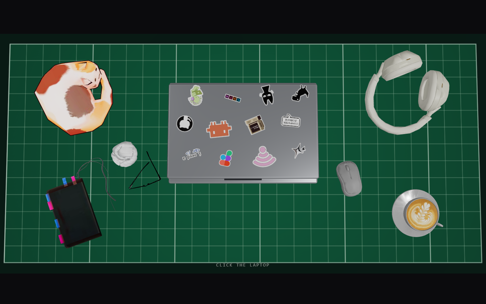
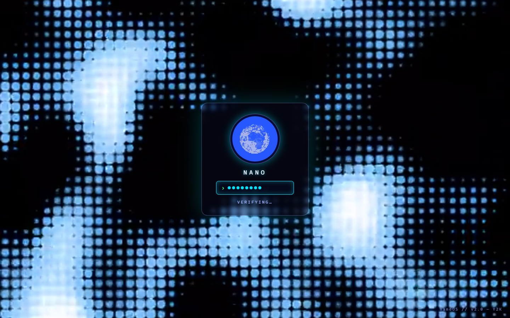
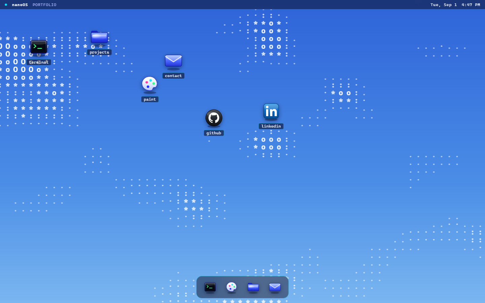
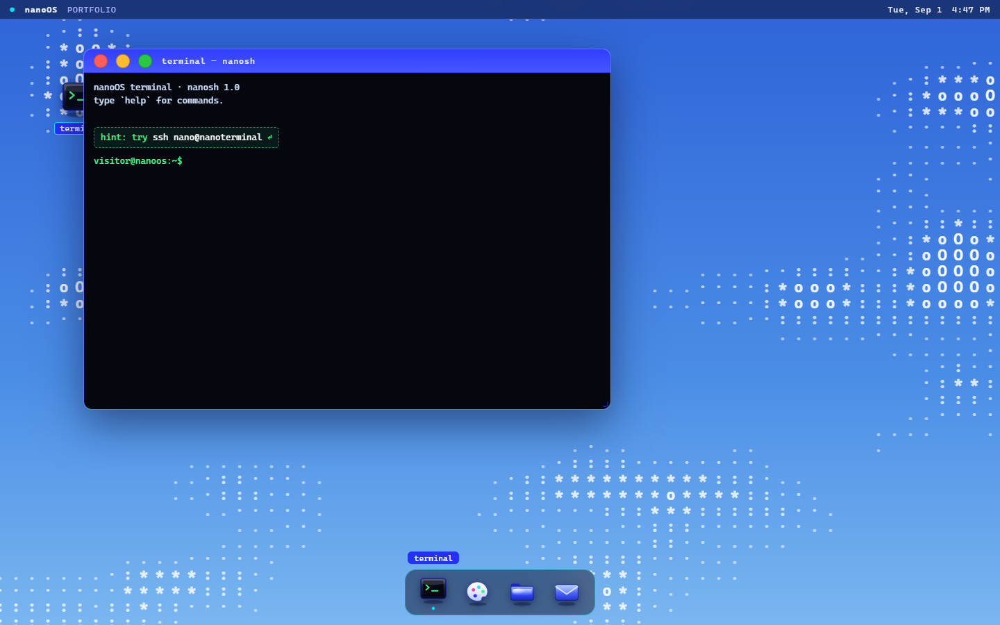
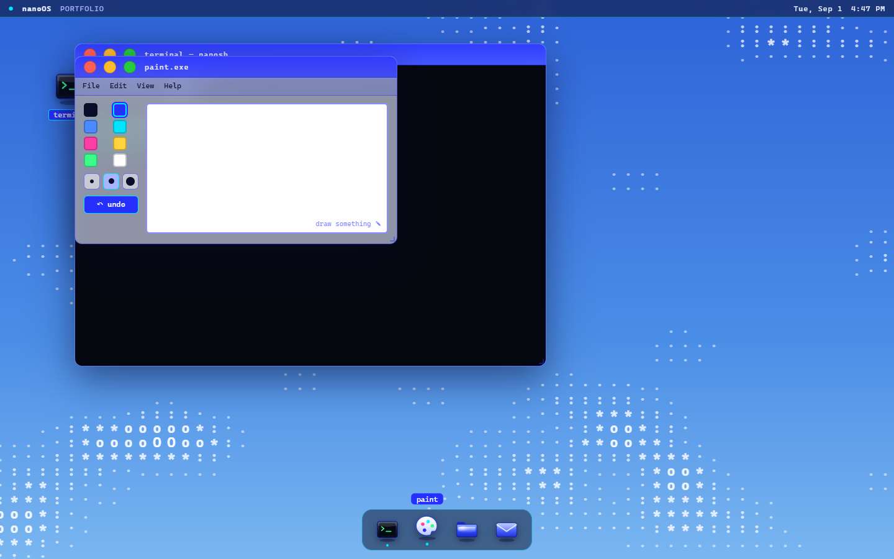

# portfolio

Nour Al Shami's portfolio site — a 3D laptop sitting on a green cutting mat.
Click it, and it opens into **nanoOS**, a tiny Y2K-cyber desktop environment
you can actually click around in.

**Live:** _(add your deployed URL here once it's live)_

|  |  |
|---|---|
|  The 3D flat-lay you land on — click the laptop to dive in |  A Y2K-cyber login sequence, no typing required |
|  The nanoOS desktop — draggable icons, dock, and an interactive ASCII-cloud wallpaper |  The terminal app, a browser re-creation of the real TUI portfolio |


*A Y2K MS-Paint-style app with a real drawable canvas, sitting right on the desktop.*

## the idea

Instead of a normal scrolling one-pager, the site is a desktop metaphor:

1. **Desk scene** — a top-down 3D flat-lay (laptop, coffee, headphones,
   notebook, a sleeping cat) built with `react-three-fiber`. Click the laptop
   and the lid opens while the camera dives into the screen.
2. **Login** — a short (~1.5s) animated "logging in" sequence (video
   background + spinning globe avatar + auto-typed password), no real input
   required; click or press Enter to skip it.
3. **nanoOS** — the actual portfolio: draggable desktop icons, glass windows
   that drag, resize (eight edge/corner handles) and have working
   traffic-light controls (close / minimize / maximize), a dock, an
   interactive ASCII-cloud wallpaper, and a handful of little apps:
   - **terminal** — a fake `nanosh` shell where `ssh nano@nanoterminal`
     connects to a browser re-creation of the real
     [terminal-portfolio](https://github.com/Nan0dev06/terminal-portfolio)
     TUI: ASCII portrait, figlet title, typed-out bio, `t` cycles the six
     themes, `q` disconnects. This is the about-me.
   - **paint** — a Y2K MS-Paint-style app with a real drawable canvas
   - **projects** — cards for real GitHub projects
   - **contact** — email / GitHub

   Plus GitHub and LinkedIn desktop shortcuts that open straight out to the
   real thing.

Phones and touch-only devices (below 900px) skip the 3D scene and the login
entirely and land straight on the desktop with projects open — the 3D code,
models and videos are never downloaded there.

It's also responsive: below ~900px the scattered desktop icons fall back to
a grid, windows and icons clamp themselves onto the visible screen, and the
terminal drops its portrait column so the TUI text stays legible on a phone.

## stack

- **React + Vite**
- **`@react-three/fiber`** / **`@react-three/drei`** / **`three`** — the 3D desk scene
- **`zustand`** — two small stores: `store.js` (3D intro phase) and
  `src/os/osStore.js` (window manager:
  open/close/minimize/maximize/drag/resize/z-order)

No backend — everything is static and runs in the browser.

## running it locally

```bash
npm install
npm run dev      # http://localhost:5173
```

Dev shortcut: open `http://localhost:5173/#os` to skip the 3D intro and land
straight on the desktop.

```bash
npm run build     # production build
npm run preview   # preview the production build
```

## project layout

```
src/
  App.jsx            entry: lazy-loaded 3D intro (desktop only) + <Overlay/>
  store.js            3D intro phase: 'closed' → 'opening' → 'entered'
  scene/               the 3D desk — laptop, mat, props, camera
                       (Intro.jsx holds the <Canvas>; it's its own chunk)
  ui/Overlay.jsx       the fullscreen page that fades in and mounts the OS
  os/
    osStore.js         window manager state (open/close/minimize/z-order/drag/resize)
    OS.jsx             power-on → Login → desktop
    Login.jsx          animated login screen
    MenuBar.jsx        top bar (nanoOS label, contact email, resume, clock)
    AsciiSky.jsx       the interactive ASCII-cloud wallpaper
    Window.jsx         glass window chrome (star buttons, drag, resize, maximize)
    Dock.jsx / DesktopIcons.jsx   the two places apps launch from
    apps.jsx           Projects / Contact
    Terminal.jsx       nanosh + the terminal-portfolio TUI re-creation
    portrait.txt       the ASCII portrait the TUI renders
    Paint.jsx          drawable-canvas paint app
    icons.jsx          the shared glossy 3D icon glyphs
    useViewport.js     live viewport size + clamp helper (responsive layout)
    data.js            ALL personal content — profile, bio, projects
public/
  models/              3D prop models (.glb)
  stickers/            laptop-lid sticker PNGs
  cursor.png, login_bg.mp4, globe.mp4, enter_bg.jpg, ...
```

**To edit your own content** (name, bio, projects), the only file you need is
[`src/os/data.js`](src/os/data.js).


